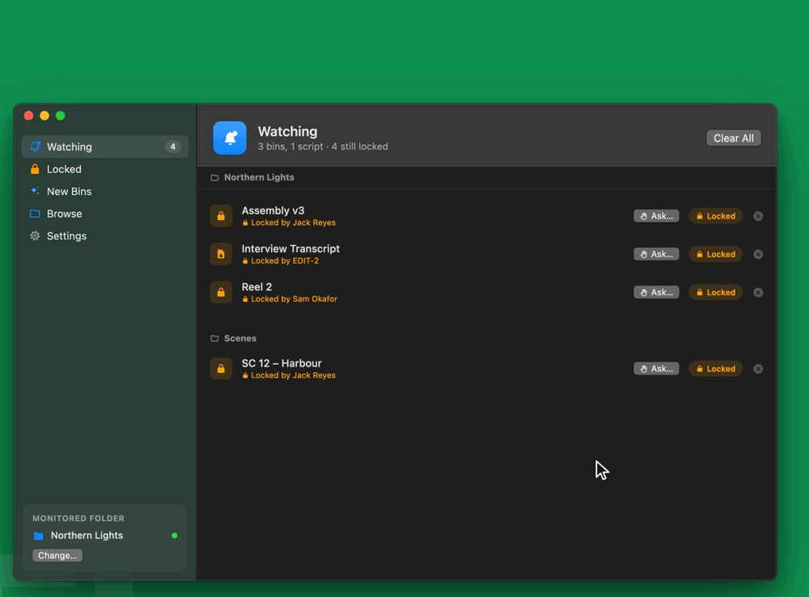
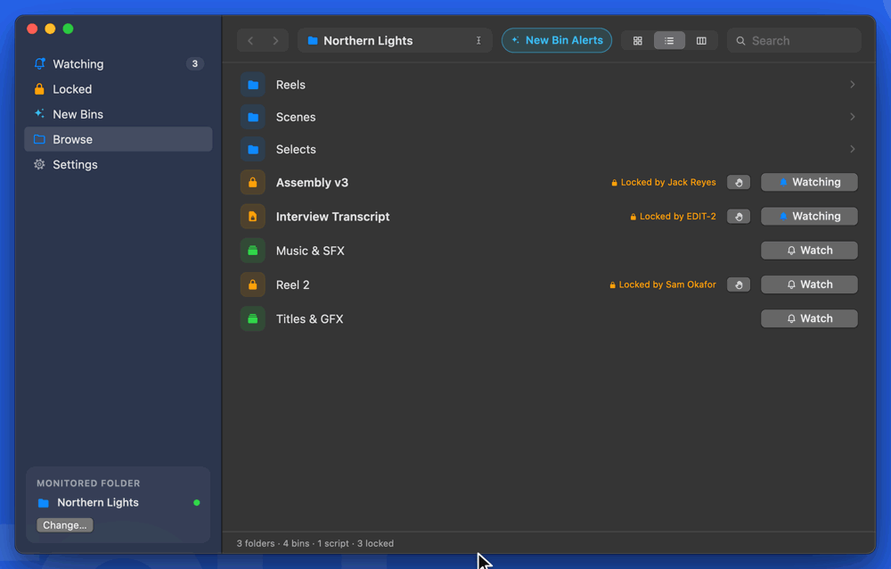
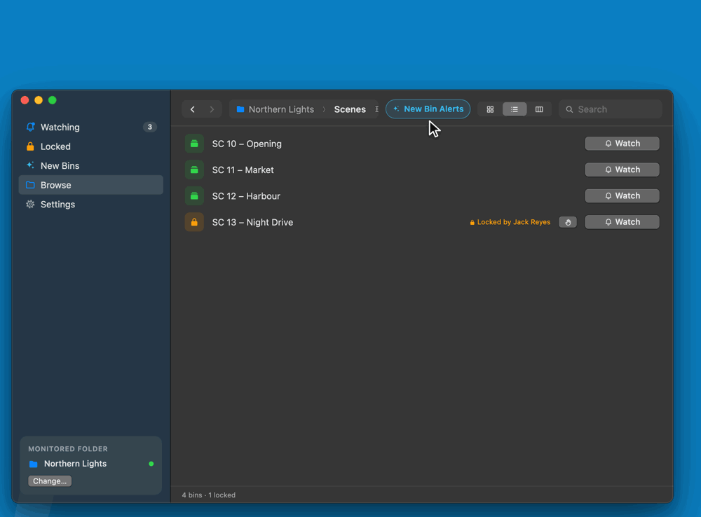
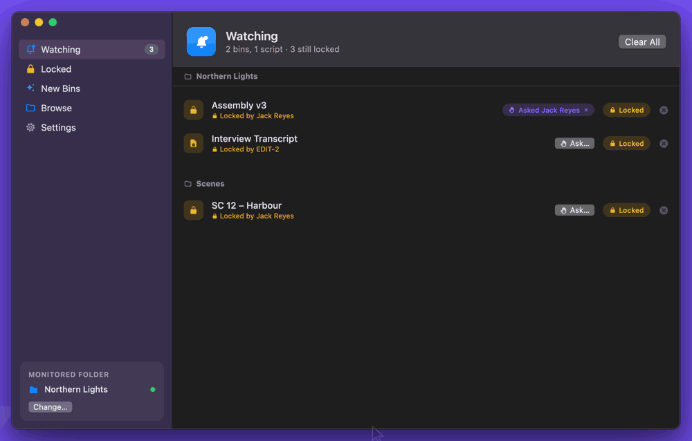
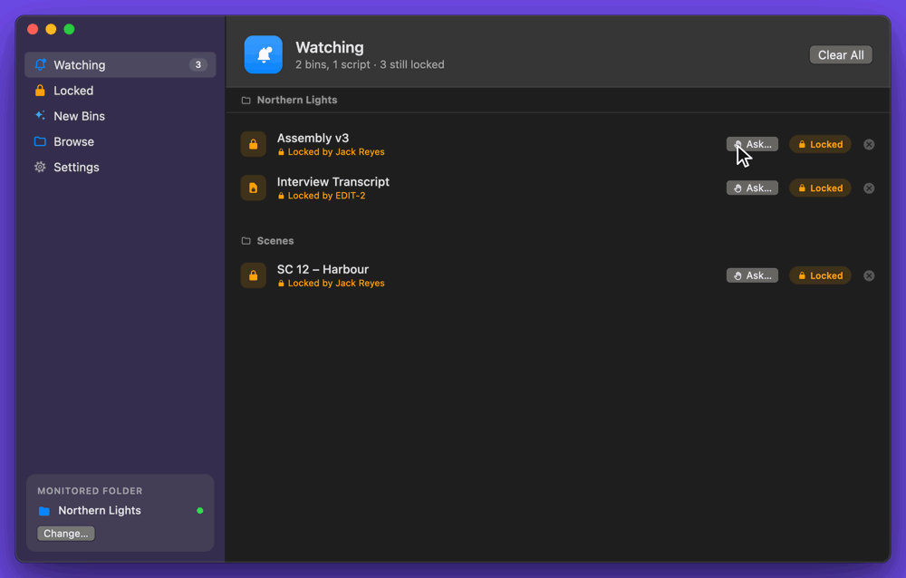

# Bin Watch


A monitoring app that tells you when an Avid bin or script someone else has open becomes free. It checks for the `.lck` file Avid keeps beside an open bin (`.avb`) or script (`.avc`), and when that file is gone you get an alert. Everything below that says "bin" works the same way for scripts.

It's free and open source. It can also ask whoever has a bin open to close it, without any network setup.

Made by **Alex Stuart**.



## Download

1. Download **Bin-Watch-x.y.zip** from the [latest release](https://github.com/absolute-cinema-jpg/bin-watch/releases/latest), unzip it, and drag **Bin Watch** into Applications.
2. **The first time you open it, macOS blocks it** because Bin Watch isn't notarised by Apple yet. Open it once, click **Done**, then go to **System Settings → Privacy & Security**, scroll down and click **Open Anyway**. On macOS 14 and earlier, right-clicking the app and choosing **Open** also works. You only need to do this once.

**Requires** macOS 13 Ventura or later. Runs natively on Apple Silicon and Intel Macs.

### Updating

From version 1.7, Bin Watch updates itself. Once a day it asks GitHub whether there's a newer version, and if there is, an **Update Available** card appears above the monitored folder. Click **Update Now** and Bin Watch downloads it, checks it and restarts into it, keeping your watched bins and settings. Nothing is installed until you click. You can also use **Check for Updates…** in the Bin Watch menu, or **Settings → Updates**, which shows what's new and lets you turn the daily check off.

Before installing, Bin Watch checks that the download matches the checksum published with the release, is a correctly signed copy of Bin Watch at the expected version, and still runs in the App Sandbox. If anything doesn't match, nothing is changed.

If you're not an administrator on your Mac, macOS may not let Bin Watch replace itself. Bin Watch then offers **Download from GitHub** instead. Versions before 1.7 can't update themselves, so install 1.7 by hand once.

## Build from source

```bash
./build.sh install     # builds and copies "Bin Watch.app" into /Applications
./build.sh             # just builds into ./build
./Tests/run.sh         # tests the lock detection, mailbox, update and bug report logic
./Tests/run-ui.sh      # clicks through the real interface offscreen, silently
```

The build only needs Apple's Command Line Tools. Xcode isn't required.

## Using it

1. Open Bin Watch from the Dock or Applications. Like Spotify, closing the window doesn't quit the app; it keeps monitoring. Click the Dock icon to bring the window back, and quit with ⌘Q.
2. **Monitored folder:** choose one folder. It can be a single Avid project or a whole "Avid Projects" folder. To change it later, use **Change…** in the bottom of the sidebar or in Settings. Watched bins that are still inside the new folder stay watched.
3. **Browse:** works like Finder. The sidebar order is Watching, Locked, New Bins, Browse, Settings.
   - **Views:** switch between Icons, List and Columns (⌘1 / ⌘2 / ⌘3). In Columns view, clicking a bin shows a preview with a big Watch button.
   - **Moving around:** click a folder to open it. Use the back and forward buttons (⌘[ and ⌘]) or ⌘↑ to go up a level, and click any part of the path bar to jump there.
   - **Type or paste a path:** click the empty part of the path bar, or press ⌘L or ⌘⇧G. Finder paths, paths from Terminal, `file://` links and Windows-style paths all work. A path that points at a bin selects that bin.
   - **Search:** looks in the current folder and everything inside it.
   - **Selecting bins:** click a bin to select it, ⌘-click to add or remove one, ⇧-click to select a range, and ⌘A to select every bin in the folder. ↑/↓ move the selection and Esc clears it.
   - **Return:** toggles watching for the selection. If every selected bin is already watched, Return stops watching them; otherwise it watches them all. Folders still open with a single click.
   - **Opening a bin:** double-click a bin or script, or select it and press ⌘O (or ⌘↓). It opens in Media Composer if Avid is already running, or is shown in Finder if it isn't, just like **Show Bin** on alerts. Several selected items are shown together in Finder. Double-clicking a folder just opens the folder; it never opens a bin the second click happens to land on.
4. **Who has it open:** a locked bin shows who has it, e.g. "Locked by Sam Okafor". Bin Watch reads the name Avid writes inside the lock file, usually the computer's name. If that Mac belongs to a colleague who uses Bin Watch, it shows their name instead, or "you" for your own Mac. It appears in Browse, on the Watching page, in the menu bar and in Columns view's preview. **Ask…** then suggests that person automatically.
5. **Locked:** lists every bin and script that's open anywhere in the monitored folder, grouped by who has it. Click a person (or computer) at the top, or on a group's heading, to see only what they have open, e.g. everything Jack has locked. Type in **Filter by name** to narrow it further. **Watch All** watches everything in a group, so you're alerted as each one frees up. Each row also has **Ask…** and **Watch**, and double-clicking opens it just like in Browse. The list is checked every 15 seconds, but only while the page is open, because listing a whole project tree is far more work than checking a few watched bins.
6. Click **Watch** on the bins you're waiting for. The **Watching** page shows their live status and has a **Clear All** button, which asks for confirmation first.



When a watched bin goes from locked to free:

- A compact alert slides in at the top right and plays your chosen sound.
- **Show Bin** opens the bin in Media Composer if Avid is already running, or shows it in Finder if it isn't. Bin Watch never launches Avid itself.
- **Dismiss** just closes the alert.
- Either way, Bin Watch stops watching that bin. You can change this in Settings.
- Several alerts stack neatly, with the newest on top. Click the stack or **Show all** to expand it into a list (it never grows past 60% of the screen), and **Clear all** dismisses them all.
- Alerts appear above everything, on every Space and in full-screen apps. They respond to the first click and never take keyboard focus from Media Composer.
- The Dock icon bounces once and shows a badge with the number of alerts waiting. The chime can repeat every minute until you respond.

**Custom sounds:** go to Settings, then **Add Sound**. Any audio file works. Bin Watch keeps its own copy, in its private sandbox folder, so your original file isn't touched. You can also set the volume there.

## New bins

Get an alert when bins appear in a folder, for example new scene bins landing in your project.



- **Turning it on:** in **Browse**, open the folder and click **New Bin Alerts** next to the path bar. The button turns solid blue when alerts are on. You can also right-click a folder and choose **Alert Me About New Bins**. New scripts count too.
- **Marked folders:** folders with alerts on show a blue ✦ badge in every view, plus a "New bin alerts" tag in List view. Folders covered because a parent folder includes subfolders show a fainter badge. A bin covered by two watched folders is only announced once.
- **The New Bins tab:** lists those folders and the bins that have recently appeared. Turn on **Include subfolders** to cover a whole tree; folders are checked every 5 seconds, or every 30 seconds with subfolders on.
- **The alert:** has **Show Bin** (or **Show Bins** for several) and **Dismiss**. Several bins that arrive together are grouped into one alert.
- **What doesn't count as new:** bins that were already there, bins moved between subfolders, and bins that vanish briefly while being saved. A workspace going offline never makes everything look new.
- **While Bin Watch was closed:** bins added meanwhile are reported the next time it starts.
- **Renames:** renaming a bin in Avid renames its file, so it shows up as a new bin. So do bins you create yourself.

## Asking for a bin

When a bin you need is locked, you can ask whoever has it open to close it. This works without Wi-Fi or any network setup: Bin Watch passes messages as small files in a shared **mailbox folder** on the same storage as your projects. It works over NEXIS, file servers and synced storage like Salon SyncBox, where it also reaches other sites.



1. **Set up (once per person):** open Settings, then **Bin Requests**, then **Choose…**, and pick the same folder as everyone else. Create a new empty folder for this, outside your Avid projects; Bin Watch refuses folders inside a project. Check **Your name**.
2. **Ask:** click **Ask…** next to any locked bin. It appears in Browse, on the Watching page, in the right-click menu, and in Columns view's preview. Choose a person, or **Everyone using Bin Watch** if you're not sure who has it, and add an optional note. Asking also watches the bin.
3. **Their side:** they get a purple request alert with **I'll close it** and **Not now** (or **Not me**, when you asked everyone). You see their answer as an alert, and on the Watching page ("Seen by Sam", "Sam is closing it").
4. **When the bin frees up:** you get the usual alert, and the request disappears from everyone's screen by itself.



Requests expire after 12 hours. Each person's Bin Watch only ever writes its own message files, and tidies up its own old ones.

**Knowing it got through.** The label next to a bin you've asked for tells you where your request is:

- **Not sent yet** (orange): the mailbox can't be reached right now. Bin Watch sends it automatically as soon as it can.
- **Asked Sam · offline** (orange): it's in the mailbox, but Sam's Bin Watch isn't running. It appears on their screen when it next connects, if that's within 12 hours.
- **Asked Sam**: it's in the mailbox and Sam is online.
- **Seen by Sam**: it has appeared on Sam's screen.

**If the connection drops.** Network volumes often mount after login items start, and drop during sleep. Bin Watch remembers the mailbox and keeps trying by itself, so nothing needs doing. If macOS itself stops letting Bin Watch into the folder, you get an alert asking you to choose the same folder again. **Settings → Bin Requests** shows the current state, and **Check Connection** tests listing, writing and reading a small file in the mailbox, then removes it.

## Read-only, guaranteed by macOS

- **The monitored folder is read-only.** Bin Watch runs in the macOS App Sandbox and opens your monitored folder through a read-only bookmark, so macOS refuses any attempt to create, change, move or delete anything there. macOS's folder picker briefly grants write access to whatever you pick, so Bin Watch restarts itself right after you choose the folder. That way it never keeps that access.
- **The code only lists folders and reads lock names.** All project access is in [Sources/ReadOnlyFS.swift](Sources/ReadOnlyFS.swift). It lists folders and checks which files exist. To show who has a bin open, it also reads the first 1 KB of a `.lck` file, read-only, and closes it straight away. Each lock file is read only once, and again only if it changes. Turn off **Show who has a locked bin or script open** in Settings and Bin Watch never opens a `.lck` file at all; it only checks whether they exist.
- **Writes only go to three places:**
  - **The request mailbox** ([Sources/Mailbox.swift](Sources/Mailbox.swift)). It can't be your monitored folder, contain it, or sit inside an Avid project. Every write goes through one guarded function that only accepts the mailbox's own subfolders.
  - **Bin Watch's private sound library** inside its sandbox container.
  - **Bin Watch.app itself, when you click Update.** macOS won't let a sandboxed app install its own update, so a small helper inside Bin Watch.app does just that ([Sources/Updater](Sources/Updater)). It starts outside the App Sandbox, but before doing anything it locks itself into a sandbox of its own: from then on macOS refuses it any network access, and any write except to Bin Watch.app, a temporary folder beside it and its own temp folder. The tools it runs to unpack and check the update are held to the same limits. Bin Watch itself still runs in the App Sandbox.
- **It only connects to GitHub, and only to check for and download updates.** Turn off **Check for updates automatically** in Settings and it only does that when you ask. Bug reports open in your browser; Bin Watch doesn't send them itself.
- **It avoids false alarms.** A bin has to look free on two checks in a row before you're alerted. A workspace dropping offline never counts as "unlocked".

To check the entitlements yourself:

```bash
codesign -d --entitlements - "/Applications/Bin Watch.app"
```

## Notes

- **Finder and `.DS_Store` files.** When **Show Bin** reveals a bin in Finder, *Finder* (not Bin Watch) may leave a hidden `.DS_Store` file in that folder on network storage. Many Avid facilities turn this off for every Mac. To do that, run this command and then log out and back in:

  ```bash
  defaults write com.apple.desktopservices DSDontWriteNetworkStores -bool true
  ```

- After a rebuild, the monitored folder may show an orange dot (meaning it can't be reached). If it does, click **Change…** and pick the same folder again. Its saved permission is tied to the app's signature.
- **Open Bin Watch when I log in** works best when the app is in /Applications.

## Feedback

Found a bug? Choose **Help → Report a Bug…** in Bin Watch, or **Report a Bug…** in **Settings → Help**. Describe what happened, and Bin Watch opens GitHub's new-issue page in your browser with your report filled in, for you to check and post. You'll need a free GitHub account.

It can add technical details: your Bin Watch and macOS versions, how Bin Watch is set up (for example whether the monitored folder is on an SMB or AFP server, and whether the mailbox is connected) and recent connection events. Click **Show What's Included** to see exactly what's added. It never includes the names of projects, bins, folders, people or computers. Reports are public, so please don't type real project or bin names either.

Have an idea instead? [Open an issue](https://github.com/absolute-cinema-jpg/bin-watch/issues).

## License

Copyright © 2026 Alex Stuart

Bin Watch is free software: you can redistribute it and/or modify it under the terms of the [GNU General Public License](LICENSE), version 3 or (at your option) any later version. It comes with no warranty. Anything you distribute that's based on it must also be shared under the GPL, with its source code.

Bin Watch is an independent project and isn't affiliated with or endorsed by Avid Technology. Avid and Media Composer are trademarks of Avid Technology, Inc.
